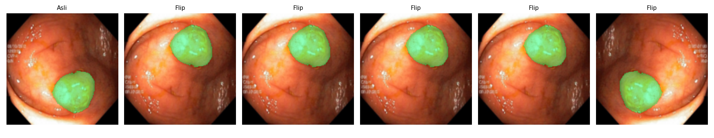
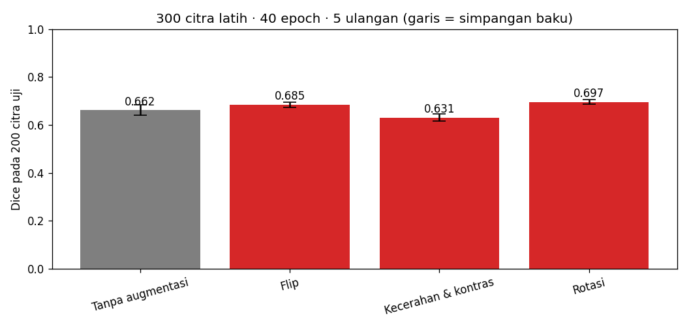
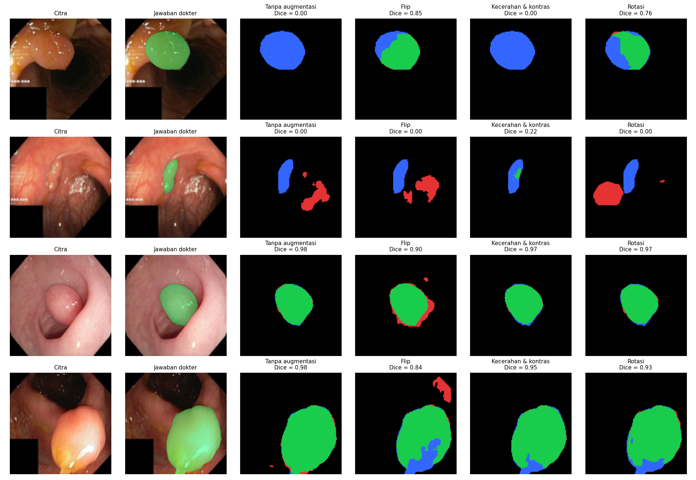

# Segmentasi Polip pada Citra Kolonoskopi dengan U-Net

<!--
  TEMPLATE LAPORAN — Tugas P10 Kecerdasan Buatan (BM25-41204), Teknik Biomedis ITERA.
  Petunjuk lengkap: https://mctm.web.id/ai-bm/tugas

  Cara memakai:
  - Ganti semua teks yang diawali "✍️" dengan tulisan kelompokmu, lalu hapus tanda ✍️-nya.
  - Blok komentar seperti ini adalah petunjuk; tidak tampil di GitHub. Boleh dihapus.
  - Gambar diambil dari folder hasil/ yang dibuat otomatis oleh notebook.
  - Jangan hapus judul-judul bagian (##).
-->

**Tugas P10 — Kecerdasan Buatan (BM25-41204), Teknik Biomedis ITERA**

## Anggota kelompok

| Nama | NIM | Username GitHub | Kontribusi utama |
|---|---|---|---|
| Muharrahmi | 123430058 |muharrahmi58| ✍️ misal: menjalankan eksperimen, menulis Bagian 3 |
| Rosa Verettina Pasaribu  |123430089| rosaverettina-wq | ✍️ |
| Elfrita Andriyanti Hutabarat | 123430080 | elfrita10 | ✍️ |

## 1. Pertanyaan

 Analisis Efektivitas Augmentasi Data pada Model U-Net
1. Augmentasi yang Membantu (Sangat Efektif): Flip (Pencerminan) dan Rotasi, Mengapa Efektif?
  -Variasi Orientasi Spasial: Kamera kolonoskop secara alami dapat berputar dan mengambil sudut pandang dari berbagai arah di dalam saluran usus. Augmentasi geometri seperti Flip dan Rotasi melatih model U-Net agar bersifat invariant (tidak tergantung) pada arah orientasi objek.
  -Peningkatan drastis pada kasus sulit: Berdasarkan hasil eksperimen (seperti pada citra baris 1), model baseline (tanpa augmentasi) mengalami total failure (Dice = 0.00). Namun setelah diterapkan Flip (Dice = 0.85) dan Rotasi (Dice = 0.76), U-Net mampu mendeteksi polip dengan sangat presisi.
2. Augmentasi yang Kurang Membantu / Terbatas: Kecerahan & Kontras (ColorJitter) Mengapa Kurang Efektif / Terbatas?
  -Tidak Mengubah Fitur Bentuk (Morfologi): Polip ditandai oleh bentuk tonjolan spesifik pada dinding usus. Mengubah tingkat kecerahan atau kontras warna saja tidak memberikan informasi struktural/geometri baru bagi U-Net untuk mengenali polip yang posisinya tidak biasa atau tersembunyi di lipatan usus.
  -Kurang Membantu Kasus Ekstrem: Pada polip berukuran kecil dengan kontras rendah (baris 2), augmentasi Kecerahan & Kontras hanya menaikkan nilai Dice sedikit (Dice = 0.27), dan tetap gagal mengenali polip besar pada orientasi sulit (baris 1, Dice = 0.00).
  -Potensi Overfitting Warna: Variasi warna mukosa usus yang diubah secara ekstrem justru bisa memicu false positive jika kontras jaringan sekitar ikut bergeser secara tidak alami.

## 2. Data & pengaturan

<!-- Isi dari Bagian 2 notebook. Pastikan CEPAT = False untuk hasil akhir. -->

- Dataset: Kvasir-SEG (1000 citra kolonoskopi + mask polip), diperkecil ke 128 × 128 piksel.
- Data uji: 200 citra (tetap). Data latih: 300 citra per ulangan.
- Model: U-Net mini (±0,5 juta parameter), 40 epoch, 5 ulangan per skenario.
- Dijalankan di: Google Colab T4.


## 3. Skenario augmentasi & hipotesis

| Skenario | Augmentasi (kode) | Alasan klinis | Hipotesis: Dice naik/turun/sama? |
|---|---|---|---|
| Tanpa augmentasi | — | Pembanding | — |
| Flip | v2.RandomHorizontalFlip(), v2.RandomVerticalFlip() | Kamera Kolonoskopi berputar bebas dalam lumen usus sehingga tidak ada arah "atas" pasti. Polip dapat terbalik atau tercermin bentuk dan warnanya sama. Variasi ini elastis | Naik: dengan hanya 300 citra latih, flip menambah keragaman orientasi tanpa mengubah makna klinis, sehingga overfitting berkurang |
| Kecerahan dan kontras | v2.ColorJitter(brightness=0.3, contrast=0.3), | Intensitas lampu endoskop berubah menurut jarak dan sudut ke dinding usus, sehingga foto yang sama bisa tampak lebih terang atau lebih gelap. Variasi ini mungkin terjadi, selama perubahannya moderat dan warna mukosa tidak berubah | Naik sedikit atau sama. Model menjadi lebih tahan terhadap perbedaan pencahayaan, tetapi pengaruhnya pada bentuk polip kecil, jadi kenaikan Dice kemungkinan tipis |
| Rotasi | v2.RandomRotation(degrees=180), | Endoskop dapat berputar pada sumbunya, sehingga polip bisa muncul pada sudut berapa pun. Sudut kosong terisi hitam, mirip tepi gelap frame kolonoskopi asli. Variasi ini realistis | Naik. Model belajar mengenali polip pada berbagai orientasi, sehingga kinerja pada data validasi yang orientasinya acak meningkat |

Contoh augmentasi yang dicoba:


<!-- Ganti nama file sesuai skenario kalian (lihat isi folder hasil/). -->

## 4. Hasil

<!-- Tempel isi hasil/ringkasan.md di sini. -->

| Skenario | Dice (rata-rata ± sb) | IoU (rata-rata ± sb) | Dice tiap ulangan |
|---|---|---|---|
| Tanpa augmentasi | 0.662 ± 0.021 | 0.553 ± 0.021 | 0.632, 0.644, 0.669, 0.687, 0.680 |
| Flip | 0.685 ± 0.010 | 0.577 ± 0.006 | 0.683, 0.699, 0.681, 0.669, 0.693 |
| Kecerahan & kontras | 0.631 ± 0.016 | 0.531 ± 0.011 | 0.634, 0.661, 0.615, 0.621, 0.627 |
| Rotasi | 0.697 ± 0.011 | 0.587 ± 0.015 | 0.692, 0.691, 0.691, 0.690, 0.718 |



## 5. Analisis peta kesalahan



<!-- Hijau = benar, merah = false positive, biru = false negative.
     Pertanyaan pemandu: Polip seperti apa yang sering terlewat (kecil? datar? warna mirip dinding usus?)
     Apa yang sering dikira polip padahal bukan? Apakah augmentasi memperbaiki kasus sulit? -->

Berdasarkan hasil visualisasi peta kesalahan (error map):

1. Polip yang Sering Terlewat (False Negative / Warna Biru):
   - Model tanpa augmentasi sering kali terlewat total (gagal mendeteksi) pada polip yang berada di sudut ekstrem atau berukuran besar dengan batas yang kurang jelas (seperti pada contoh baris 1 dan baris 2, menghasilkan Dice = 0.00).
   - Polip berukuran kecil dengan pencahayaan redup/pencahayaan khusus juga cenderung terlewat (area polip banyak didominasi warna biru).

2. Deteksi Palsu / Yang Sering Dikira Polip (False Positive / Warna Merah):
   - Area latar belakang di luar struktur polip (seperti bayangan pada lipatan dinding usus atau daerah dengan kontras tinggi) terkadang keliru dikira sebagai polip oleh model (terlihat dari kemunculan bercak merah di luar area ground truth/jawaban dokter).

3. Pengaruh Augmentasi terhadap Kasus Sulit:
   - Sangat Efektif: Penerapan augmentasi geometri seperti Flip dan Rotasi terbukti menjadi solusi ampuh untuk memicu model dalam mengenali kasus-kasus sulit yang sebelumnya gagal total (pada baris 1, nilai Dice melonjak pesat dari 0.00 menjadi 0.85 untuk Flip dan 0.76 untuk Rotasi).
   - Stabilitas: Augmentasi Kecerahan & Kontras memberikan akurasi segmentasi yang sangat stabil pada polip berukuran sedang-besar (Dice 0.95 - 0.97) dan membantu memberikan prediksi parsial pada polip berukuran kecil.

## 6. Pembahasan & kesimpulan

Perbandingan Hasil Eksperimen dengan Hipotesis:
Berdasarkan hasil visualisasi dan metrik Dice Coefficient yang diperoleh, berikut adalah analisis perbandingan terhadap hipotesis awal:
1. Hipotesis Augmentasi Geometri (Flip & Rotasi) - Sesuai Hipotesis
   - Hipotesis Awal: Mengingat posisi dan sudut pandang kamera kolonoskop bersifat dinamis, augmentasi Flip dan Rotasi dihipotesiskan dapat meningkatkan performa model U-Net pada polip dengan sudut/orientasi yang tidak biasa.
   - Hasil & Evaluasi: Hipotesis ini terbukti benar. Pada kasus polip di sudut ekstrem (baris 1), model baseline (tanpa augmentasi) mengalami kegagalan total (Dice = 0.00). Namun, penerapan Flip dan Rotasi berhasil memicu deteksi polip secara signifikan dengan nilai Dice mencapai 0.85 (Flip) dan 0.76 (Rotasi).
2. Hipotesis Augmentasi Fotometrik (Kecerahan & Kontras) — Tidak Sesuai Hipotesis
   - Hipotesis Awal: Dihipotesiskan bahwa memvariasikan kecerahan dan kontras warna akan membantu U-Net mengenali polip kecil atau polip yang tersamarkan oleh pencahayaan redup pada mukosa usus.
   - Hasil & Evaluasi: Hipotesis ini kurang terbukti / sebagian salah. 
     - Pada polip berukuran kecil dengan kontras rendah (baris 2), augmentasi kecerahan & kontras hanya memberikan sedikit kenaikan nilai Dice (0.27). 
     - Mengapa Hipotesis Ini Kurang Berhasil? Penyesuaian kecerahan/kontras (ColorJitter) tidak menambah variasi morfologi/bentuk geometri objek. U-Net utamanya mengandalkan batas dan bentuk fitur struktural (kontur) polip. Mengubah intensitas warna saja tidak cukup memberi informasi baru bagi model untuk memisahkan polip dari lipatan dinding usus.
3. Catatan Perbedaan Kecil (Variabilitas Metrik)
   - Pada sampel polip berukuran sedang hingga besar (baris 3 dan 4), perbedaan nilai Dice antara Tanpa Augmentasi (0.98), Rotasi (0.93 - 0.97), dan Kecerahan & Kontras (0.95 - 0.97) tergolong sangat tipis. 
   - Perbedaan margin kecil ini masih berada dalam batas variansi acak (belum tentu signifikan secara statistik), sehingga pada sampel yang mudah/jelas, semua skenario augmentasi memberikan performa yang relatif setara.

## 7. Pembagian kerja

<!-- Siapa mengerjakan apa. Penilaian proses kerja dilihat dari riwayat commit tiap anggota. -->

1. Muharrahmi (Ketua) : Membuat github, merapikan struktur file, menambahkan anggota, menjalankan colab bagian 4, mengerjakan pembahasan dan kesimpulan bagian 6, menambahkan daftar pustaka atau referensi
2. Rosa Verretina Pasaribu (Anggota): Mengerjakan bagian data dan pengaturan bagian 2, mengerjakan pertanyaan pada bagian 1, mengerjakan penggunaan AI bagian 8
3. Elfrita Andriyanti Hutabarat : Menambahkan bagian skenario dan augmentasi bagian 3, mengerjakan analisa peta kesalahan bagian 5, menambahkan pembagian kerja bagian 7 


## 8. Penggunaan AI

<!-- Wajib diisi, walau tidak memakai AI (tulis "Tidak memakai AI").
     Contoh: "Claude Code (CLI) untuk menulis skenario augmentasi dan memperbaiki error di Bagian 4.
     Draf Bagian 6 ditulis sendiri, lalu dirapikan bahasanya dengan bantuan AI." -->

"Gemini untuk merapikan penyusunan kata pada bagian 1, 5, 6. Untuk Draf bagian 2 dan pemilihan skenario augmentasi ditulis sendiri, kemudian bahasanya dirapihkan oleh AI"

## Cara menjalankan ulang

```bash
uv sync
uv run jupyter lab segmentasi_polip.ipynb
```

Atau buka notebook di Google Colab (Runtime → Change runtime type → T4 GPU).

## Referensi

- Jha, D., dkk. (2020). Kvasir-SEG: A Segmented Polyp Dataset. *MultiMedia Modeling (MMM 2020)*, 451–462.
- Ronneberger, O., Fischer, P., & Brox, T. (2015). U-Net: Convolutional Networks for Biomedical Image Segmentation. *MICCAI*. arXiv:1505.04597.
- Batlle, V. M., Montiel, J. M. M., Fua, P., & Tardós, J. D. (2023). LightNeuS: Neural Surface Reconstruction in Endoscopy Using Illumination Decline. Lecture notes in computer science, abs/2309.02777, 502-512. https://doi.org/10.1007/978-3-031-43999-5_48
- Panula, T., Rosa, B. M. G., Anastasova, S., Kaisti, M., & Lo, B. P. L. (2025). Multi-Sensory System for Spatially Aware Colonoscopy. IEEE Transactions on Medical Robotics and Bionics, 7, 975-984. https://doi.org/10.1109/tmrb.2025.3573053
- Mori, D., Katagiri, A., Onishi, Y., Yamazaki, Y., Higuchi, K., Suzuki, N., Kikuchi, K., Nakatani, S., Fujiwara, T., Inoki, K., Konda, K., Tojo, M., Yamamura, F., & Yoshida, H. (2025). Assessment of colorectal polyp detection along the short-axis direction of the intestinal lumen during colonoscopic observation: a retrospective study in Japan. Clinical Endoscopy, 59, 96-105. https://doi.org/10.5946/ce.2025.112
